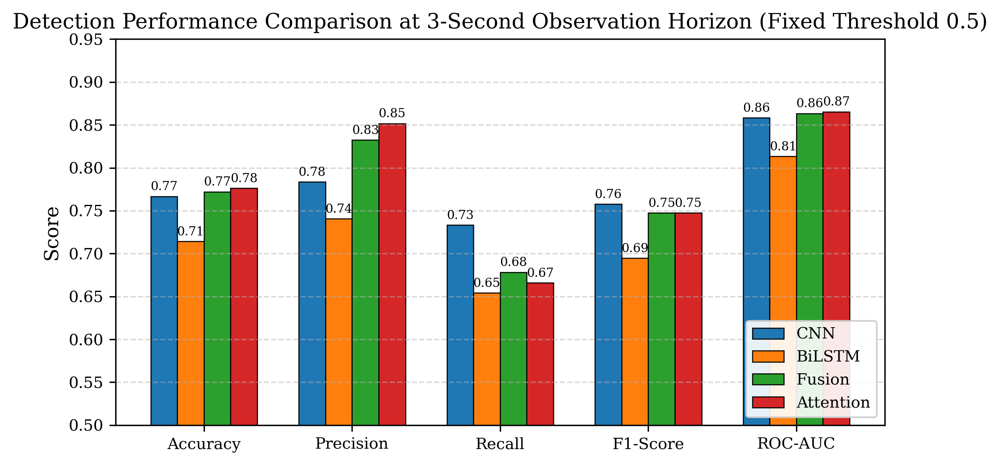
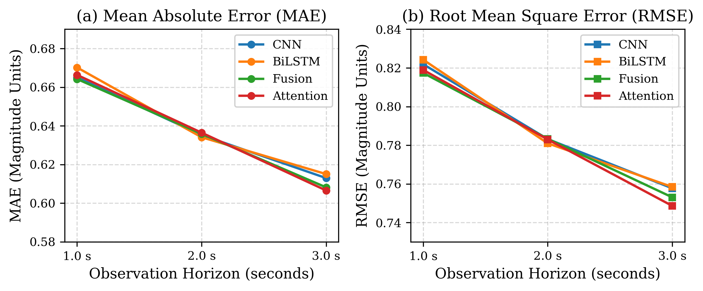
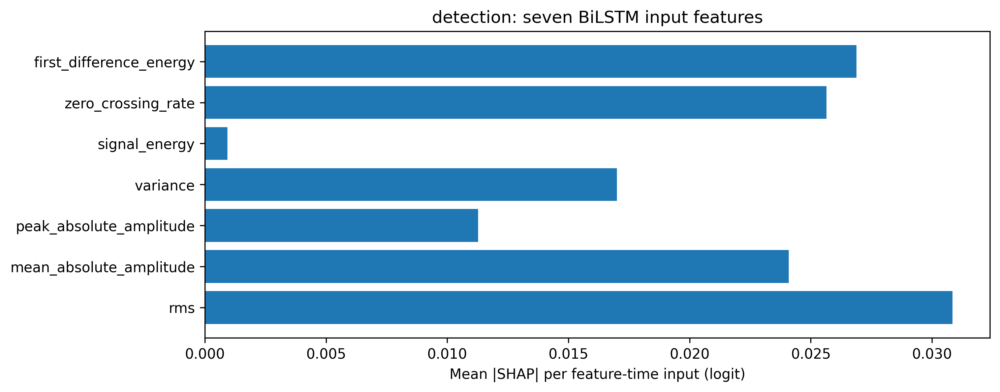
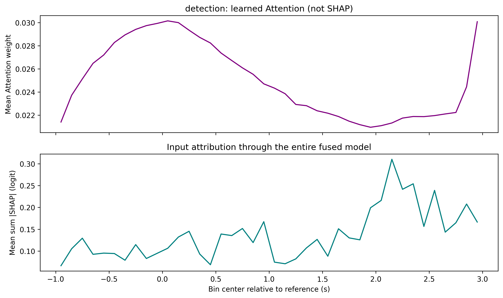

# Physics-Informed Synthetic Benchmark for Deep Learning Earthquake Early Warning (Northeast India)

> **Controlled comparison of 1D-CNN, Tabular BiLSTM, Frozen Feature Fusion, and Temporal Attention on strictly causal, oracle-P aligned synthetic P-wave windows (1.0 s, 2.0 s, 3.0 s) calibrated to the Northeast India & Indo-Burma seismic zone.**

---

## Project Overview

Earthquake Early Warning (EEW) systems detect fast-traveling compressional ($P$) waves and estimate earthquake magnitude before slower, destructive shear ($S$) waves arrive. In high-hazard regions such as **Northeast India (Seismic Zone V)** and the Indo-Burma subduction margin, continuous broadband telemetry is sparse, hindering reproducible deep learning benchmarks.

This repository implements an end-to-end **physics-informed synthetic seismic waveform simulator**, causal feature/window extraction pipelines, **four deep learning EEW architectures**, **independent leakage & provenance audits**, **SHAP Expected Gradients explainability**, an **IEEEtran research manuscript**, and the **B.Tech. Minor Project thesis**.

> **Important Scope & Scientific Disclaimer:**
> The source file [`dataset_2.csv`](dataset_2.csv) contains historical earthquake catalog metadata ($N = 8,089$ events), not recorded continuous station seismograms. All waveform and ambient noise traces are **100% synthetically generated** using physics-informed forward modeling with **oracle $P$-arrival alignment**. Accordingly, this project is a **controlled architectural research benchmark**—it does not establish operational real-time triggering, streaming detection latency, or real-world earthquake prediction performance.

---

## Authors & Academic Context

**Institution:** Department of Computer Science & Engineering, University of Science and Technology Meghalaya (USTM), Ri-Bhoi, Meghalaya 793101, India  
**Session:** August–December 2026 (B.Tech. Minor Project)  
**Project Supervisor:** Dr. Manashee Kalita, Assistant Professor, Dept. of CSE, USTM

| Scholar Name | Roll / Scholar ID |
| :--- | :--- |
| **Mustafizur Rahman Choudhury** | `2023/BCSE/0054` |
| **Kingshuk Das** | `2023/BCSE/0043` |
| **Lakshman Sharma** | `2023/BCSE/0041` |
| **Meghraj Dhakal** | `2023/BCSE/0027` |

---

## Key Highlights & Results

- **Physics-Informed Synthetic Dataset (16,178 balanced records):** 8,089 catalog-parameterized synthetic earthquakes + 8,089 matched ambient noise traces across four distinct noise families, calibrated to empirical pre-$P$ RMS floors (resolving an earlier $+6.21\text{ dB}$ crest-factor SNR bias).
- **Strict Causality & Common Test Cohort:** All models are evaluated on the exact same held-out, S-wave eligibility-masked common test cohort of **2,414 records** (1,200 earthquakes, 1,214 noise traces; ordered `source_id` SHA256: `862b467ff6219c5193f4c99257a5971eea395581669302748d006faa78b78601`).
- **Best Detection vs. Lowest False Alarms (3.0 s Horizon, Fixed Threshold `0.50`):**
  - **1D-CNN (`EarlyCNN`)** achieves the highest detection **$F_1$-score (`0.7576`)** and **recall (`0.7333`)**, with `0.2002` FPR.
  - **Attention Fusion** achieves the lowest **false positive rate (`11.45%`)**, highest **precision (`0.8518`)**, highest **ROC-AUC (`0.8654`)**, and lowest **magnitude MAE (`0.6066`)**.
- **No Statistically Significant Attention Gain:** Paired class-stratified bootstrap resampling (500 replicates, seed `2026`) shows Attention minus Fusion 95% confidence intervals cross zero for both $F_1$ (`[-0.0060, +0.0065]`) and MAE (`[-0.0064, +0.0032]`).
- **Transparent Failure-Mode Documentation:** All architectures exhibit severe **regression variance compression** ($\sigma_{\hat{M}} / \sigma_M \approx 0.51\text{--}0.60$) and underpredict **87.02%–96.95%** of strong earthquakes ($M \ge 5.0$, $N = 131$) within short 3.0 s $P$-wave windows.
- **Hyperparameter Tuning Audit:** 12 controlled tuning trials on the 3.0 s Attention head produced **0/12 candidates** meeting pre-declared replacement gates; the baseline model was retained.
- **SHAP Explainability Verdict (`CONDITIONAL`):** `rms`, `first_difference_energy`, and `zero_crossing_rate` (detection) / `mean_absolute_amplitude` (magnitude) rank highest, with documented background-reference sensitivity (`1.974`-logit shift) and detection reconstruction residuals.

---

## Physics-Informed Synthesis Pipeline

Source modules live in [`cnn/cnn wave/data wave/synthetic_waveform_simulator/`](cnn/cnn%20wave/data%20wave/synthetic_waveform_simulator/) (formulas documented in [`paper/01_synthesis_formulas.md`](paper/01_synthesis_formulas.md)):

| Component | Formulation / Specification |
| :--- | :--- |
| **Catalog Domain** | 8,089 events ($D \in [1.0, 486.2]\text{ km}$, $h \in [5.0, 70.0]\text{ km}$, $R \in [5.1, 488.5]\text{ km}$, $M \in [2.0, 7.2]$) |
| **Sampling & Duration** | $f_s = 100.0\text{ Hz}$, $T = 100.0\text{ s}$ ($10,000$ samples/trace) |
| **Crustal Kinematics** | 1D homogeneous model: $V_P = 6.0\text{ km/s}$, $V_S = 3.5\text{ km/s}$ ($t_P = R/V_P$, $t_S = R/V_S$) |
| **Source & Spreading** | $A_{\text{source}}(M) = 10^{0.50(M - 4.0)}$, spherical spreading $\mathcal{G}(R) = (10.0 / \max(R, 10.0))^{1.0}$ |
| **Attenuation $Q(f)$** | Power-law $Q_P(f) = 350(f/1.0)^{0.70}$ ($f_P = 5.0\text{ Hz}$), $Q_S(f) = 300(f/1.0)^{0.70}$ ($f_S = 2.2\text{ Hz}$) |
| **BHZ Amplitude Ratio** | Calibrated vertical-component S/P amplitude ratio $r_{\text{BHZ}} = 1.35$ |
| **Wave Packets** | $C^1$-continuous Gamma onset envelopes with magnitude-dependent rise time & distance-dependent coda decay |
| **Noise Categories (4)** | `gaussian_bandlimited` (0.2–25 Hz Butterworth), `colored_pink` ($1/f$), `modulated_nonstationary` (0.01–0.04 Hz envelope), `transient_disturbances` |
| **Partitioning** | Leakage-safe, pair-aware stratified split: **Train 11,324 (70%) / Val 2,426 (15%) / Test 2,428 (15%)** (seed `42`) |
| **Causal Windows** | 1.0 s pre-$P$ context ($100$ samples) + $h \in \{1.0, 2.0, 3.0\}\text{ s}$ post-$P$ ($200/300/400$ total samples); pre-$S$ eligibility masked |

---

## Model Architectures

All models are trained in PyTorch (`AdamW`, `lr = 1e-3`, `weight_decay = 1e-4`, `batch_size = 256`, `seed = 42`) with equal-weight multi-task loss $\mathcal{L} = \mathcal{L}_{\text{BCE}} + \mathcal{L}_{\text{Huber}}(\delta = 1.0)$ where magnitude regression masks out noise records and standardizes targets on eligible training earthquakes only.

| Model | Input Representation | Architecture Summary | Trainable Params | Code / Report |
| :--- | :--- | :--- | :---: | :--- |
| **1D-CNN (`EarlyCNN`)** | Raw normalized waveform, $\text{sign}(x)\log(1+\lvert x \rvert)$ (`200`/`300`/`400` samples) | 3 strided `Conv1d` blocks (`1→16→32→48`, BN, ReLU) + Global Avg/Max Pool (`96D→32D`) + Dual Heads | **14,674** | [`cnn/cnn wave/eew_causal_v3/cnn_eew_training/`](cnn/cnn%20wave/eew_causal_v3/cnn_eew_training/) |
| **Tabular BiLSTM** | 7 features across consecutive `0.1 s` bins (`20`/`30`/`40` steps): `rms`, `mean_abs`, `peak_abs`, `variance`, `energy`, `zcr`, `first_diff_energy` | 2-layer BiLSTM (`32` hidden/dir → `64D`) + temporal mean pool + `64→32` SiLU + Dual Heads | **37,730** | [`bilstm_eew/bilstm_training_v1/`](bilstm_eew/bilstm_training_v1/) |
| **Feature Fusion (`v1`)** | Frozen `32D` CNN + frozen `32D` BiLSTM penultimate embeddings (`64D`, train-standardized) | `Linear(64, 32)` → SiLU → `Dropout(0.2)` + Dual Heads | **2,146** *(backbones frozen)* | [`fusion/cnn_bilstm_v1/`](fusion/cnn_bilstm_v1/) |
| **Attention Fusion (`v1`)** | Frozen `32D` CNN embedding + all frozen `64D` BiLSTM hidden states (`20`/`30`/`40` steps) | Additive Attention (`Linear(64,32) → tanh → Linear(32,1) → softmax`) + concat (`96D→32D` SiLU) + Dual Heads | **5,282** *(backbones frozen)* | [`fusion/cnn_bilstm_attention_v1/`](fusion/cnn_bilstm_attention_v1/) |

---

## Benchmark Results (Common Test Cohort, $N = 2,414$)

Evaluated on the identical common cohort (`1,200` earthquakes, `1,214` noise traces) at the primary policy-matched **fixed threshold (`0.50`)** from [`final_comparison/four_model_eew_v1/final_metrics_table.csv`](final_comparison/four_model_eew_v1/final_metrics_table.csv):

| Horizon | Model | Accuracy | Precision | Recall | F1-Score | FPR | ROC-AUC | PR-AUC | MAE | RMSE | $R^2$ | $M \ge 5$ Underpred. |
| :---: | :--- | :---: | :---: | :---: | :---: | :---: | :---: | :---: | :---: | :---: | :---: | :---: |
| **1.0 s** | CNN | 0.6611 | 0.6306 | 0.7683 | 0.6927 | 0.4448 | 0.7487 | 0.7473 | 0.6650 | 0.8219 | 0.1644 | 97.71% |
| **1.0 s** | BiLSTM | 0.6284 | 0.5725 | **0.9975** | **0.7274** | 0.7364 | 0.6759 | 0.6519 | 0.6702 | 0.8242 | 0.1596 | 97.71% |
| **1.0 s** | Fusion | 0.6529 | 0.6276 | 0.7417 | 0.6799 | 0.4349 | 0.7466 | 0.7449 | **0.6642** | **0.8174** | **0.1736** | 98.47% |
| **1.0 s** | Attention | **0.6632** | **0.6513** | 0.6942 | 0.6720 | **0.3674** | **0.7513** | **0.7489** | 0.6664 | 0.8189 | 0.1704 | 98.47% |
| **2.0 s** | CNN | 0.7245 | 0.7408 | **0.6858** | 0.7122 | 0.2372 | 0.8255 | 0.8455 | 0.6353 | 0.7832 | 0.2413 | 94.66% |
| **2.0 s** | BiLSTM | 0.6736 | 0.7000 | 0.6008 | 0.6466 | 0.2545 | 0.7632 | 0.7775 | **0.6341** | **0.7810** | **0.2455** | **93.13%** |
| **2.0 s** | Fusion | 0.7349 | 0.7652 | 0.6733 | 0.7163 | 0.2043 | 0.8320 | 0.8493 | 0.6359 | 0.7833 | 0.2410 | 94.66% |
| **2.0 s** | Attention | **0.7357** | **0.7661** | 0.6742 | **0.7172** | **0.2035** | **0.8322** | **0.8494** | 0.6365 | 0.7830 | 0.2416 | 95.42% |
| **3.0 s** | CNN | 0.7668 | 0.7836 | **0.7333** | **0.7576** | 0.2002 | 0.8585 | 0.8825 | 0.6130 | 0.7577 | 0.2898 | 96.95% |
| **3.0 s** | BiLSTM | 0.7142 | 0.7406 | 0.6542 | 0.6947 | 0.2265 | 0.8132 | 0.8346 | 0.6151 | 0.7584 | 0.2885 | 96.18% |
| **3.0 s** | Fusion | 0.7722 | 0.8323 | 0.6783 | 0.7475 | 0.1351 | 0.8634 | 0.8861 | 0.6082 | 0.7531 | 0.2985 | 92.37% |
| **3.0 s** | Attention | **0.7763** | **0.8518** | 0.6658 | 0.7474 | **0.1145** | **0.8654** | **0.8875** | **0.6066** | **0.7486** | **0.3067** | **87.02%** |

<p align="center">
  
  
</p>

### Explainability (XAI / SHAP Audit)

From [`explainability/final_attention_shap_v1/shap_explainability_report.md`](explainability/final_attention_shap_v1/shap_explainability_report.md) (SHAP Expected Gradients, 2,048 draws, 48-record paired backgrounds, 3.0 s Attention model):

- **Top Tabular Features — Detection:** `rms`, `first_difference_energy`, `zero_crossing_rate`
- **Top Tabular Features — Magnitude:** `rms`, `mean_absolute_amplitude`, `first_difference_energy`
- **Verdict (`CONDITIONAL`):** Magnitude satisfies reconstruction tolerance on `9/9` earthquakes (max residual `0.0240` units), whereas detection fails strict tolerance on `4/12` validation cases (max residual `0.6226` logits) and shifts baseline expectation by `1.974` logits across alternative training backgrounds. Attributions serve as qualitative diagnostics rather than causal proof.

<p align="center">
  
  
</p>

---

## Repository Structure

```text
.
├── dataset_2.csv                                # Historical seismic catalog metadata (8,089 events)
├── preprocess.py / preprocess_dl_temporal.py    # Early catalog EDA & tabular preprocessing pipelines
├── cnn/
│   └── cnn wave/
│       ├── data wave/synthetic_waveform_simulator/  # Physics-informed simulator (Phases 1–11)
│       ├── eew_causal_v2/                           # Causal dataset prototype v2
│       └── eew_causal_v3/                           # Causal dataset v3 + standalone 1D-CNN training & audit
├── bilstm_eew/
│   ├── causal_tabular_v1/                       # 7-feature 0.1 s bin extraction & validation notebooks
│   └── bilstm_training_v1/                      # Standalone Tabular BiLSTM training, evaluation & audit
├── fusion/
│   ├── cnn_bilstm_v1/                           # Frozen CNN + BiLSTM concatenation fusion + audit
│   └── cnn_bilstm_attention_v1/                 # Frozen CNN + BiLSTM + Temporal Attention + audit
├── model_improvement/
│   ├── error_diagnosis_v1/                      # Regression variance compression & strong-event diagnosis
│   └── attention_tuning_v1/                     # 12-trial 3 s Attention tuning study (0/12 promoted)
├── explainability/
│   ├── final_attention_shap_v1/                 # SHAP Expected Gradients pipeline, report & 12 plots
│   └── shap_reliability_v1/                     # SHAP background sensitivity & Monte Carlo stability checks
├── final_comparison/
│   ├── four_model_eew_v1/                       # Master CSV metrics, comparison plots & conclusion
│   └── four_model_eew_v2/                       # Consolidated research summary & limitations
├── paper/
│   ├── main.tex / main.pdf                      # 18-page IEEEtran journal manuscript
│   ├── references.bib                           # Verified bibliography
│   ├── 00_inventory.md                          # Complete code, hyperparameter & metric audit
│   ├── 01_synthesis_formulas.md                 # Numbered physics simulation equations
│   ├── 02_model_comparison.md                   # Model comparison tables & bootstrap analysis
│   ├── 99_open_issues.md                        # Submission & verification checklist
│   └── figures/generate_figures.py              # Script generating IEEEtran paper figures
├── thesis/
│   ├── generate_thesis.py                       # Programmatic python-docx USTM thesis builder
│   └── thesis_final.docx                        # Formatted B.Tech. Minor Project thesis (Times New Roman)
├── project_report/                              # Consolidated academic report drafts (v1 & SHAP edition)
├── Research Papers/                             # Reference PDFs & archived experiment mirrors
├── bilstm/ & bilstm new updated/                # Earlier catalog sequence-forecasting iterations
└── cleanup_audit_2026-11-13/                    # Cleanup audit logs and archive plan
```

> **Note on Ignored Binary Artifacts (`.gitignore`):** Large HDF5 waveforms/feature archives (`*.h5`, `*.npz` up to ~1.26 GB), PyTorch weight checkpoints (`*.pt`, `*.pth`), virtual environments, and compiled shared libraries (`*.dll`, `*.so`) are excluded to respect GitHub's 100 MB file limit. You can regenerate the synthetic waveforms, tabular features, figures, and thesis using the scripts below.

---

## Reproducing Key Artifacts

### 1. Environment Setup
Verified runtime stack used in training and evaluation:
- Python 3.10+ (trained with Python 3.13, PyTorch `2.6.0+cu124` on NVIDIA GeForce RTX 3050 Laptop GPU)
- Core libraries: `torch`, `numpy`, `pandas`, `scipy`, `scikit-learn`, `h5py`, `matplotlib`, `shap`, `python-docx`

```bash
pip install torch numpy pandas scipy scikit-learn h5py matplotlib shap python-docx
```

### 2. Regenerate Synthetic Waveforms & Causal Splits
```bash
python3 "cnn/cnn wave/data wave/synthetic_waveform_simulator/run_pipeline.py" --all
python3 "cnn/cnn wave/data wave/synthetic_waveform_simulator/phase9_generate_full_dataset.py"
python3 "cnn/cnn wave/data wave/synthetic_waveform_simulator/phase10_generate_classification_dataset.py"
python3 "cnn/cnn wave/data wave/synthetic_waveform_simulator/phase11_split_and_preprocess.py"
```

Then run the notebooks in order:
1. `cnn/cnn wave/eew_causal_v3/` (`01` → `03`) to build causal waveform windows, followed by `cnn_eew_training/` (`01` → `02`).
2. `bilstm_eew/causal_tabular_v1/` (`01` → `02`) to extract `0.1 s` binned features, followed by `bilstm_eew/bilstm_training_v1/` (`01` → `02`).
3. `fusion/cnn_bilstm_v1/` and `fusion/cnn_bilstm_attention_v1/` (`01` → `02`).
4. `explainability/final_attention_shap_v1/01_final_attention_shap.ipynb` for SHAP Expected Gradients.

### 3. Regenerate Paper Figures, LaTeX Manuscript, and `.docx` Thesis
```bash
# Regenerate publication figures from final_metrics_table.csv
python3 paper/figures/generate_figures.py

# Compile IEEEtran manuscript (requires tectonic or pdflatex + bibtex)
tectonic -X compile paper/main.tex

# Regenerate formatted USTM B.Tech. thesis (thesis/thesis_final.docx)
python3 thesis/generate_thesis.py
```

---

## Known Limitations & Threats to Validity

1. **Synthetic Waveforms & Oracle Alignment:** Evaluates idealized 1D crustal kinematics (`Vp = 6.0 km/s`, `Vs = 3.5 km/s`) with oracle $P$-onset alignment rather than field-recorded seismograms or real-time phase pickers.
2. **Magnitude Variance Compression:** Short 1.0–3.0 s $P$-wave windows carry incomplete rupture information for large fault dimensions, causing systematic underprediction (`87.02%–96.95%`) on $M \ge 5.0$ earthquakes.
3. **False Alarm Trade-Offs & Shortcuts:** Post-$P$-zeroed diagnostics and noise-family breakdowns (`colored_pink` vs. `gaussian_bandlimited` / `transient_disturbances`) reveal background-family shortcut sensitivity.
4. **Single-Seed Exploratory Evaluation:** Results reflect seed `42` runs on a previously inspected benchmark cohort; bootstrap intervals are descriptive rather than multi-seed confirmatory tests.
