# Earthquake Early Warning Using CNN, BiLSTM, and Temporal Attention

## Minor Project Report

**Research context:** Northeast India seismicity  
**Scope:** Synthetic oracle-P-aligned benchmark  
**Student(s):** [Names and enrolment numbers]  
**Department / Institution:** [Department / Institution]  
**Supervisor:** [Name and designation]  
**Academic session:** [Session]  
**Prepared:** 15 November 2026  
**Revision:** Final academic report with completed SHAP analysis

Institutional certificates, declarations and signatures must be supplied through the institution's approved process. No certification is asserted here.

## Abstract

This study compares a one-dimensional convolutional neural network (CNN), a tabular bidirectional long short-term memory network (BiLSTM), their feature fusion, and fusion with temporal Attention for synthetic earthquake/noise detection and early magnitude estimation. Catalog-informed simulation supplies 8,089 earthquake and 8,089 noise records. The original CSV is not a recorded waveform dataset. Models use 1s, 2s and 3s post-oracle-P observations with one second of preceding context. The BiLSTM receives features from the same synthetic observations as the CNN. On a common cohort of 1,200 earthquakes and 1,214 noise records, the 3s CNN has the highest fixed-threshold F1 (0.757641), whereas Attention has the lowest magnitude MAE (0.606601). Available paired intervals do not support Attention improvement over non-Attention fusion. Twelve subsequent validation-only tuning trials fail the predeclared replacement criteria. Magnitude compression, strong-event underprediction and false-positive/recall tradeoffs remain substantial. The contribution is a reproducible controlled synthetic comparison, not an operational warning system or evidence of real-world earthquake prediction. The completed SHAP expected-gradient study of the frozen 3s Attention model has a CONDITIONAL verdict: initial reconstruction passed 8/12 detection cases and 9/9 magnitude cases. A targeted 8,192-draw diagnostic reduced mean reconstruction error but did not establish consistent detection reliability. Background sensitivity and shared-source input dependence prevent causal or independent-branch interpretations; SHAP did not improve prediction accuracy.

**Keywords:** earthquake early warning; CNN; BiLSTM; temporal attention; synthetic seismic signals; Northeast India; SHAP; explainable AI.

## Contents

1. Introduction
2. Literature Review
3. Dataset and Preprocessing
4. Proposed Methodology
5. Experimental Setup
6. Results and Discussion
7. Hyperparameter Tuning
8. Explainable AI Analysis Using SHAP
9. Conclusion and Future Scope
10. References

# Chapter 1 — Introduction

## 1.1 Earthquake hazards and early warning

Earthquake early warning concerns an earthquake that has already begun. Early observations may permit alerts before subsequent shaking reaches a location. It differs from predicting a future earthquake's time, place and magnitude. [USGS explanation](https://www.usgs.gov/faqs/what-difference-between-earthquake-early-warning-earthquake-forecasts-earthquake-probabilities) [R1].

Warning usefulness involves accuracy, timeliness and the consequences of missed and false alerts. Classification success alone is insufficient. The review by [Allen and Melgar (2019)](https://doi.org/10.1146/annurev-earth-053018-060457) [R2] provides the wider scientific and societal context for assessing these competing objectives.

## 1.2 Northeast India seismic context

Northeast India motivates the research. The National Institute of Disaster Management documents major earthquake occurrences in the region, including the 1950 Assam earthquake. This history motivates seismic-risk research without establishing regional deployment validity for the models studied here. [NIDM institutional resource](https://nidm.gov.in/PDF/pubs/EQ%20North%20East.pdf) [R3].

The inspected project reports do not establish the catalog's exact geographic coverage, collection dates, completeness or magnitude-type harmonization. Therefore no representative Northeast India station coverage, regional calibration or operational generalization is claimed.

## 1.3 Problem statement and research motivation

The research problem is to compare waveform and temporal tabular representations for earthquake/noise classification and same-event magnitude estimation using short, already observed synthetic P-wave windows. Fusion and Attention are tested as hypotheses, not assumed improvements. The study asks whether additional architectural complexity produces meaningful improvements when identities, eligibility and threshold policies are controlled.

## 1.4 Objectives and scope

The objectives are to compare four architectures, report detection and earthquake-only regression jointly, preserve causal cutoff and split constraints, examine paired uncertainty, and retain negative tuning findings. The scope excludes next-catalog-earthquake forecasting, autonomous P picking, prediction before earthquake initiation and real-world deployment. Northeast India is the regional motivation; the measured outcomes concern a synthetic oracle-aligned benchmark.

# Chapter 2 — Literature Review

## 2.1 Earthquake early warning

EEW balances information acquired after onset against time remaining for action. Source characterization and expected shaking are distinct from binary event classification. [Allen and Melgar](https://doi.org/10.1146/annurev-earth-053018-060457) [R2] review scientific and societal requirements. The present project measures fixed-window classification and magnitude errors rather than complete alert delivery.

## 2.2 CNNs for seismic signals

ConvNetQuake demonstrates convolutional earthquake detection and location from waveforms, with application to Oklahoma seismicity. It provides a precedent for learned seismic representations; its data, outputs and performance are not reproduced or imported into this project. [Perol, Gharbi and Denolle (2018)](https://groups.csail.mit.edu/graphics/convnetquake/) [R4].

## 2.3 LSTM and bidirectional temporal processing

LSTM addresses learning dependencies over time, while bidirectional recurrent networks process a sequence in both directions. These foundations motivate the temporal branch, but do not imply earthquake forecasting capability. [Hochreiter and Schmidhuber (1997)](https://doi.org/10.1162/neco.1997.9.8.1735) [R5]; [Schuster and Paliwal (1997)](https://deeplearning.cs.cmu.edu/F20/document/readings/Bidirectional%20Recurrent%20Neural%20Networks.pdf) [R6].

Here bidirectionality is restricted to the observed window. Intermediate states cannot be interpreted as depending only on earlier bins, but the final decision uses no samples beyond its declared cutoff.

## 2.4 Attention and seismic deep learning

Earthquake Transformer applies attentive deep learning to detection and phase picking. It establishes a relevant research direction, but its observational dataset and architecture differ from this project's small additive Attention head. No equivalent phase-picking capability is claimed. [Mousavi et al. (2020)](https://www.nature.com/articles/s41467-020-17591-w.pdf) [R7].

The transformer earthquake alerting model (TEAM) processes multi-station strong-motion data and was evaluated in Japan and Italy. It links deep learning to warning accuracy and timeliness. This project lacks that observational, network-level evaluation. [Münchmeyer et al., arXiv version revised 2021](https://arxiv.org/abs/2009.06316) [R8].

## 2.5 Research gap addressed

The contribution is a local controlled benchmark of four representations, not a claim that CNN–BiLSTM–Attention is a novel or universally superior method. Identical cohorts and threshold policies are necessary to distinguish numerical gains from evaluation differences. Shared-source fusion may encode redundant information; its value must be measured. Literature motivates the methods, while project results determine the conclusions.

# Chapter 3 — Dataset and Preprocessing

## 3.1 Catalog and synthetic records

The original `dataset_2.csv` is the catalog source identified in the project specification. It is **not a real recorded waveform dataset**. The specified 8,089 earthquake sources underpin physically inspired, catalog-informed simulations comprising 8,089 earthquake and 8,089 noise parent records. These counts follow the supplied project description; this report does not reopen the catalog or reconstruct waveforms.

Simulated P/S components and background noise are generated observations, not independent measured sensor records. Exact generator equations, physical units, catalog provider, regional/date filters and magnitude harmonization are not fully established in the permitted final reports and remain provenance details to supply. Physically inspired does not mean a validated physical forward model.

**Table 3.1. Parent partitions, documented in the fusion report.**

| Partition | Records | Approximate proportion |
|---|---:|---:|
| Training | 11,324 | 70% |
| Validation | 2,426 | 15% |
| Test | 2,428 | 15% |
| Total | 16,178 | 100% |

## 3.2 Observation windows and split protection

Sampling is 100 Hz; nominal parent length is 10,000 samples according to the supplied dataset specification. Each model window contains 100 pre-reference samples plus 100/200/300 post-reference samples. Oracle P alignment is an explicit assumption, not a learned trigger. Pre-S eligibility requires the observation cutoff before the annotated S arrival. Arrival annotations and masks govern offline evaluation, not network inputs.

Existing event/parent partitions are preserved. Audits checked sample identity pairing, labels, targets and masks and reported zero cross-split parent overlap. Existing causal normalization and train-fitted scalers are reused. No whole-record future normalization is introduced by training. Exact upstream preprocessing equations are not reconstructed from incomplete report detail. Noise magnitude sentinel −1 is excluded from regression.

## 3.3 Seven-feature temporal representation

Consecutive completed 10-sample bins yield RMS, mean absolute amplitude, peak absolute amplitude, variance, signal energy, zero-crossing rate and first-difference energy. These are the established project feature names. Exact conventions for zero handling, variance denominator and first-difference boundaries require the validated feature-definition artifact before equation-level reproduction; they are not guessed here. The same definitions apply to earthquake and noise observations.

**Table 3.2. Input tensor shapes.**

| Horizon | CNN | BiLSTM | Pre-reference bins |
|---|---|---|---:|
| 1s | (N,1,200) | (N,20,7) | 10 |
| 2s | (N,1,300) | (N,30,7) | 10 |
| 3s | (N,1,400) | (N,40,7) | 10 |

The tabular model processes features from synthetic observations, not historical catalog sequences. No true magnitude, event identity, future S observation or oracle timestamp is an input feature.

# Chapter 4 — Proposed Methodology

## 4.1 Standalone CNN

EarlyCNN applies a signed-log transform to the normalized waveform, followed by three strided Conv1D stages with channels 1→16→32→48. Temporal mean/max pooling gives 96 dimensions, projected to a shared 32-dimensional representation and separate detection/magnitude heads. The model report gives 14,674 parameters. Exact kernels are not provided in the permitted final report; none are invented.

**Figure 4.1. Documented CNN architecture.**

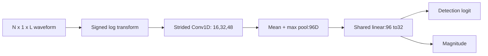

## 4.2 Standalone tabular BiLSTM

Two bidirectional LSTM layers with 32 units per direction produce 64-dimensional states. Interlayer dropout is 0.2. Temporal mean pooling, dropout 0.2 and a 64→32 SiLU shared layer precede binary and magnitude heads. The reported parameter count is 37,730.

**Figure 4.2. Observed-window BiLSTM.**

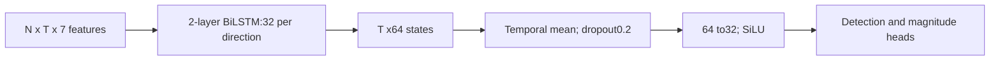

## 4.3 Frozen feature fusion

Corresponding pretrained CNN and BiLSTM backbones are frozen in evaluation mode. Their 32D shared representations are concatenated and standardized with training-only moments. A 64→32 SiLU/dropout-0.2 layer feeds separate heads. Only 2,146 fusion-head parameters are trained.

**Figure 4.3. Non-Attention fusion.**

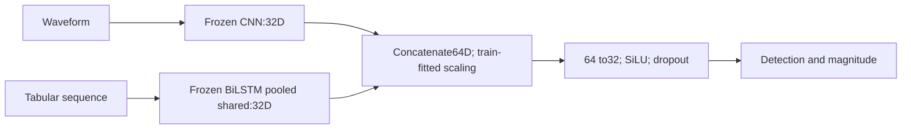

## 4.4 Temporal Attention fusion

The CNN supplies its frozen 32D embedding. The BiLSTM supplies all observed 64D hidden states, bypassing its original mean/shared head. Training-only channel moments scale both branches. Linear(64,32), tanh and Linear(32,1) produce attention scores; softmax over time normalizes weights. A weighted sum yields 64D; concatenation with the CNN yields 96D. Linear(96,32), SiLU, dropout0.2 and two heads complete the model, with 5,282 trainable parameters excluding backbones.

For standardized state h_t, scores are e_t = vᵀ tanh(W h_t + b), weights α_t = exp(e_t)/Σ_j exp(e_j), and the pooled representation is z = Σ_t α_t h_t. Attention acts on 20/30/40 states, not one pooled vector. Weights are diagnostics, not proof of physical feature importance.

**Figure 4.4. Temporal Attention on the observed sequence.**

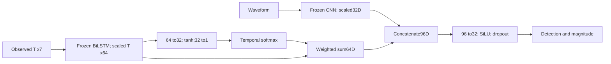

# Chapter 5 — Experimental Setup

## 5.1 Implementation and budgets

The completed experiments use PyTorch and Jupyter notebooks; reports identify PyTorch2.6.0+cu124 and an NVIDIA GeForce RTX3050 Laptop GPU. Original training uses AdamW learning rate0.001, weight decay0.0001, batch256, seed42 and gradient clipping5. This writing task performs no training or inference.

**Table 5.1. Original budgets and selected epochs (1s/2s/3s).**

| Model | Maximum epochs | Patience | Minimum improvement | Selected epochs | Trainable parameters |
|---|---:|---:|---:|---|---:|
| CNN | 50 | 8 | 0.0001 | 16/15/14 | 14,674 |
| BiLSTM | 35 | 7 | 0.0001 | 18/27/26 | 37,730 |
| Fusion | 35 | 7 | 0.0001 | 2/15/27 | 2,146 head only |
| Attention | 35 | 7 | 0.0001 | 3/17/32 | 5,282 head only |

The3s Attention model reached the35-epoch cap; epoch32 was best on validation. Early selection alone is not an error, while reaching a cap does not establish convergence.

## 5.2 Losses and model selection

Binary cross-entropy with logits is combined with equally weighted Huber(delta1) on standardized magnitudes. Magnitude mean and population SD are fitted only on eligible training earthquakes. The batch loss is mean BCE over classification-eligible records plus mean Huber over regression-eligible earthquakes; an empty regression mask contributes zero. Noise sentinels never enter regression.

Validation selection minimizes full-set mean BCE plus earthquake mean Huber. CNN reports threshold0.5. The other models additionally select validation F1 thresholds from0.10 to0.90 in0.01 increments, ties closest to0.5 then lower. Test metrics do not select checkpoints or thresholds.

## 5.3 Independent audits and evaluation protocol

Existing audits reproduced frozen metrics and checked pairing, masks, scaling, checkpoint selection and frozen weights. The common cohort is1,200 earthquakes and1,214 noise at every horizon. Larger horizon-specific1s/2s populations in original standalone reports are not substituted.

Detection accuracy, precision, recall, F1 and FPR are reported. FPR is FP/(FP+TN), not false discovery rate or false alarms per hour. Magnitude MAE/RMSE/R² include all eligible earthquakes regardless of detection success. Saved paired class-stratified bootstrap intervals use500 resamples and seed2026. These are descriptive, single-seed intervals without multiplicity adjustment.

# Chapter 6 — Results and Discussion

## 6.1 Fixed-threshold comparison

**Table6.1. Four-model common-test results at threshold0.5.**

| Horizon | Model | Accuracy | Precision | Recall | F1 | FPR | MAE | RMSE | R2 |
|---|---|---:|---:|---:|---:|---:|---:|---:|---:|
| 1s | CNN | 0.661143 | 0.630643 | 0.768333 | 0.692712 | 0.444811 | 0.665020 | 0.821894 | 0.164370 |
| 1s | BiLSTM | 0.628418 | 0.572453 | 0.997500 | 0.727438 | 0.736409 | 0.670213 | 0.824230 | 0.159615 |
| 1s | Fusion | 0.652858 | 0.627645 | 0.741667 | 0.679908 | 0.434926 | 0.664240 | 0.817358 | 0.173570 |
| 1s | Attention | 0.663215 | 0.651290 | 0.694167 | 0.672045 | 0.367381 | 0.666359 | 0.818941 | 0.170365 |
| 2s | CNN | 0.724524 | 0.740774 | 0.685833 | 0.712246 | 0.237232 | 0.635296 | 0.783164 | 0.241270 |
| 2s | BiLSTM | 0.673571 | 0.700000 | 0.600833 | 0.646637 | 0.254530 | 0.634122 | 0.780973 | 0.245509 |
| 2s | Fusion | 0.734880 | 0.765152 | 0.673333 | 0.716312 | 0.204283 | 0.635879 | 0.783324 | 0.240961 |
| 2s | Attention | 0.735708 | 0.766098 | 0.674167 | 0.717199 | 0.203460 | 0.636489 | 0.782980 | 0.241627 |
| 3s | CNN | 0.766777 | 0.783615 | 0.733333 | 0.757641 | 0.200165 | 0.613005 | 0.757702 | 0.289803 |
| 3s | BiLSTM | 0.714167 | 0.740566 | 0.654167 | 0.694690 | 0.226524 | 0.615082 | 0.758421 | 0.288455 |
| 3s | Fusion | 0.772162 | 0.832311 | 0.678333 | 0.747475 | 0.135091 | 0.608215 | 0.753055 | 0.298488 |
| 3s | Attention | 0.776305 | 0.851812 | 0.665833 | 0.747428 | 0.114498 | 0.606601 | 0.748621 | 0.306725 |

ROC-AUC and average-precision PR-AUC are retained in the CSV. Rates are fractions, not percentages. FPR is FP/(FP+TN).

### Numerical leaders, not statistically established winners

| Horizon | Highest F1 | Lowest MAE | Lowest RMSE / highest R2 |
|---|---|---|---|
| 1s | BiLSTM | Fusion | Fusion |
| 2s | Attention | BiLSTM | BiLSTM |
| 3s | CNN | Attention | Attention |

At 1s, BiLSTM's highest F1 accompanies a 73.64% noise FPR. At 2s, Attention's numerical F1 lead over fusion is only 0.000887; BiLSTM has the lowest MAE and RMSE. At 3s, CNN leads F1, while Attention has the lowest MAE and RMSE. None of these rankings establishes a universally best architecture or an operational selection rule. Metric priorities and costs matter.

## 6.2 Separate validation-selected policy

**Table6.2. Test outcomes at validation-selected thresholds.**

| Horizon | Model | Threshold | Accuracy | Precision | Recall | F1 | FPR |
|---|---|---:|---:|---:|---:|---:|---:|
| 1s | BiLSTM | 0.47 | 0.627175 | 0.571497 | 0.999167 | 0.727107 | 0.740527 |
| 1s | Fusion | 0.42 | 0.632560 | 0.576453 | 0.983333 | 0.726825 | 0.714168 |
| 1s | Attention | 0.28 | 0.626761 | 0.571224 | 0.999167 | 0.726887 | 0.741351 |
| 2s | BiLSTM | 0.36 | 0.627589 | 0.571769 | 0.999167 | 0.727328 | 0.739703 |
| 2s | Fusion | 0.41 | 0.721624 | 0.691860 | 0.793333 | 0.739130 | 0.349259 |
| 2s | Attention | 0.41 | 0.719138 | 0.689130 | 0.792500 | 0.737209 | 0.353377 |
| 3s | BiLSTM | 0.36 | 0.648302 | 0.589404 | 0.964167 | 0.731584 | 0.663921 |
| 3s | Fusion | 0.36 | 0.751036 | 0.721033 | 0.814167 | 0.764775 | 0.311367 |
| 3s | Attention | 0.41 | 0.761806 | 0.771503 | 0.740000 | 0.755423 | 0.216639 |

CNN: no audited validation-selected common-cohort operating point is supplied in the inspected summaries; marked unavailable rather than substituting0.5 or another cohort. No threshold was fitted for this report. Fusion and Attention thresholds were selected by validation F1; high recall can be purchased at substantial FPR.

The entries above are **test outcomes at thresholds selected on validation**, not validation performance. No thresholds were refitted here. CNN's corresponding audited common-cohort operating point is unavailable; it is not invented. The fixed-0.5 table remains the primary controlled threshold-policy comparison.

## 6.3 Confusion matrices

**Table6.3. Fixed0.5 common-test counts, reconstructed exactly from full-precision CSV recall/FPR and known class totals; accuracy consistency checked. No new inference. Matrix order is actual rows/predicted columns [noise,earthquake].**

| Horizon | Model | TN | FP | FN | TP |
|---|---|---:|---:|---:|---:|
| 1s | CNN | 674 | 540 | 278 | 922 |
| 1s | BiLSTM | 320 | 894 | 3 | 1197 |
| 1s | Fusion | 686 | 528 | 310 | 890 |
| 1s | Attention | 768 | 446 | 367 | 833 |
| 2s | CNN | 926 | 288 | 377 | 823 |
| 2s | BiLSTM | 905 | 309 | 479 | 721 |
| 2s | Fusion | 966 | 248 | 392 | 808 |
| 2s | Attention | 967 | 247 | 391 | 809 |
| 3s | CNN | 971 | 243 | 320 | 880 |
| 3s | BiLSTM | 939 | 275 | 415 | 785 |
| 3s | Fusion | 1050 | 164 | 386 | 814 |
| 3s | Attention | 1075 | 139 | 401 | 799 |

## 6.4 Existing verified performance figures

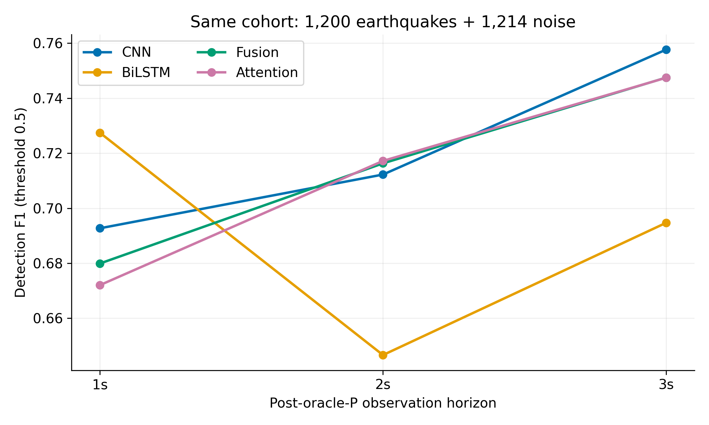

**Figure 6.1.** Four-model F1 at fixed0.5. Existing300-DPI figure; unchanged.

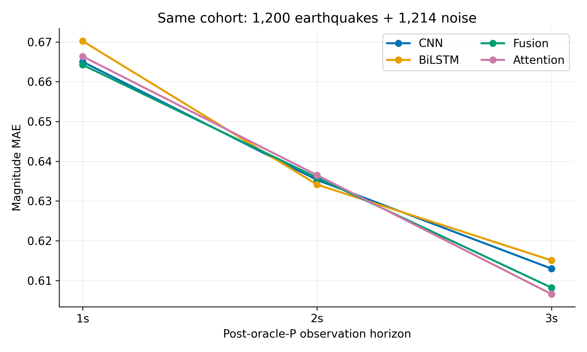

**Figure 6.2.** Magnitude MAE on eligible earthquakes. Existing300-DPI figure; unchanged.

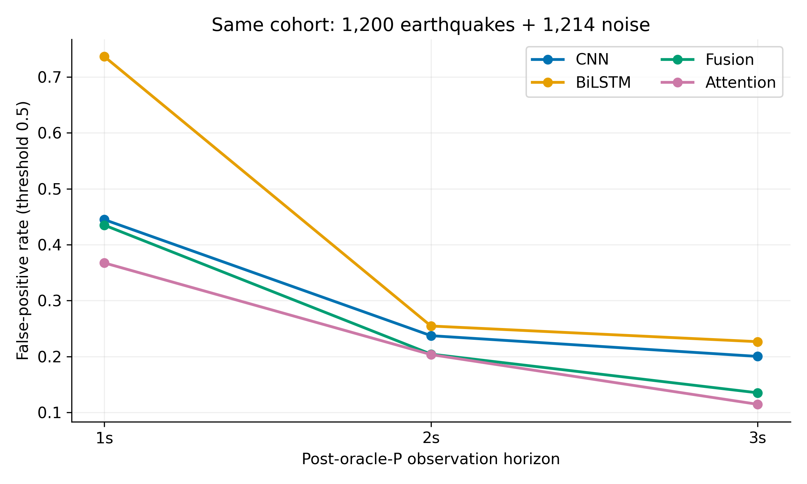

**Figure 6.3.** Four-model FPR at fixed0.5. Existing300-DPI figure; unchanged.

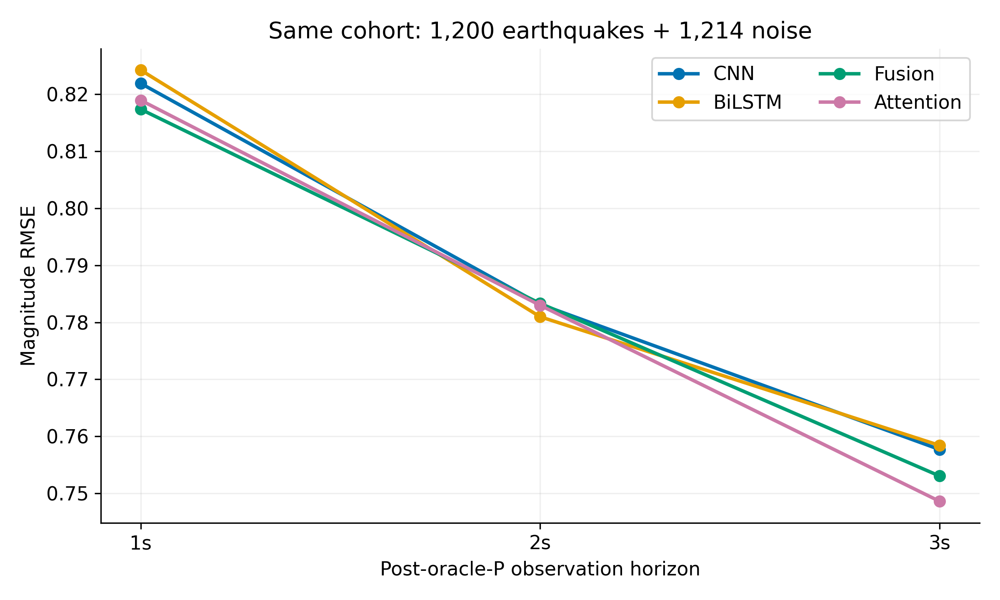

**Figure 6.4.** Magnitude RMSE. Existing300-DPI figure; unchanged.

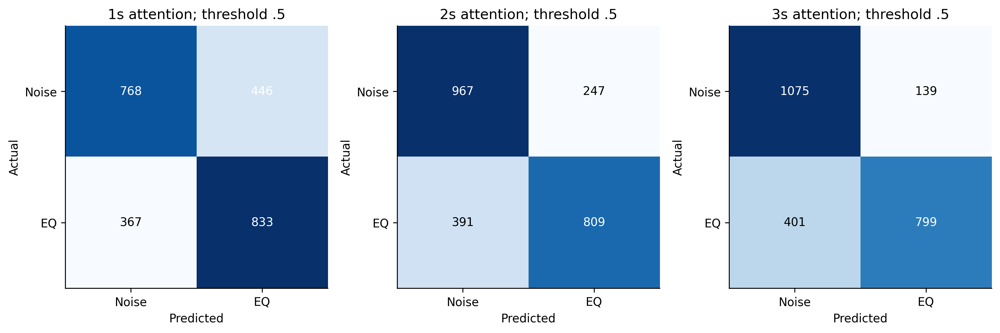

**Figure 6.5.** Attention confusion matrices, common cohort, fixed0.5. Existing300-DPI figure; unchanged.

## 6.5 Paired uncertainty

**Table6.4. Saved paired differences and uncertainty.**

Differences are candidate minus comparator. Positive F1 and negative MAE favor the candidate. These saved500-resample, seed2026, paired class-stratified percentile95% intervals use identical records; magnitude resamples earthquakes only. No new intervals or tests computed.

| Horizon | Candidate − comparator | F1 difference [95% CI] | MAE difference [95% CI] |
|---|---|---|---|
| 1s | Fusion − CNN | -0.012804 [-0.023792306807676085, -3.167606590949191e-05] | -0.000780 [-0.0034688999352511015, 0.0017248650634428485] |
| 1s | Fusion − BiLSTM | -0.047530 [-0.06428662499380051, -0.03231501238265269] | -0.005973 [-0.015197540121152996, 0.0032984839810524117] |
| 1s | Attention − Fusion | -0.007863 [-0.018330848456274, 0.001981389353165757] | 0.002119 [-0.0012190080509753896, 0.0054234042880125346] |
| 2s | Fusion − CNN | 0.004066 [-0.0051605001703711765, 0.014231114089397819] | 0.000583 [-0.004587645235005766, 0.005602469923906027] |
| 2s | Fusion − BiLSTM | 0.069675 [0.04497768064970756, 0.09491167683694436] | 0.001757 [-0.0046189094544388356, 0.008094231225550173] |
| 2s | Attention − Fusion | 0.000887 [-0.003969822205396578, 0.005982555642963445] | 0.000610 [-0.0018039557384327053, 0.002919959701830521] |
| 3s | Fusion − CNN | -0.010166 [-0.02269079653232397, -0.000400259480366555] | -0.004790 [-0.011949946149252355, 0.0021605384710710472] |
| 3s | Fusion − BiLSTM | 0.052784 [0.031601839949213034, 0.0756103546455666] | -0.006867 [-0.014054152299650013, 0.001418869048939083] |
| 3s | Attention − Fusion | -0.000047 [-0.006012117100356584, 0.0065387337626778815] | -0.001614 [-0.0063754469039849935, 0.003244647354586046] |

All Attention-versus-fusion F1 and MAE intervals include zero. There is no statistically supported Attention advantage under these saved comparisons, and absence of significance is not proof of equivalence. Every fusion-versus-standalone MAE interval also spans zero. Fusion F1 is lower than BiLSTM at1s and higher at2s/3s in the descriptive intervals. Against CNN, fusion has lower1s/3s point estimates; the1s interval barely excludes zero and is sensitive to bootstrap Monte Carlo uncertainty. The2s F1 interval crosses zero. No consistent fusion superiority is established.

Attention has **no statistically supported improvement over non-Attention fusion** at any horizon on F1 or MAE under the saved intervals. Lack of significance does not establish equivalence. No new confidence intervals, significance tests or claims of general superiority are added.

## 6.6 Magnitude compression and diagnosis

### Preserved common-test summaries

| Horizon | Model | Signed error | Predicted/actual SD | M>=5 N | Underprediction (%) | Strong signed error |
|---|---|---:|---:|---:|---:|---:|
| 1s | CNN | -0.101660 | 0.411175 | 131 | 97.710 | -1.381391 |
| 1s | BiLSTM | -0.076714 | 0.342184 | 131 | 97.710 | -1.409562 |
| 1s | Fusion | -0.074875 | 0.395727 | 131 | 98.473 | -1.364506 |
| 1s | Attention | -0.076292 | 0.387569 | 131 | 98.473 | -1.373537 |
| 2s | CNN | -0.065797 | 0.544796 | 131 | 94.656 | -1.162961 |
| 2s | BiLSTM | -0.054940 | 0.482220 | 131 | 93.130 | -1.202630 |
| 2s | Fusion | -0.067043 | 0.489833 | 131 | 93.893 | -1.218227 |
| 2s | Attention | -0.056138 | 0.512419 | 131 | 95.420 | -1.182187 |
| 3s | CNN | -0.090770 | 0.513718 | 131 | 96.947 | -1.164218 |
| 3s | BiLSTM | -0.082112 | 0.516038 | 131 | 96.183 | -1.134616 |
| 3s | Fusion | -0.061756 | 0.569917 | 131 | 92.366 | -1.047271 |
| 3s | Attention | -0.004881 | 0.600623 | 131 | 87.023 | -0.930820 |

SD ratios below1 show compressed magnitude predictions. Underprediction is the fraction of M>=5 records with predicted magnitude below truth; negative signed error means underestimation. All rows use the common-cohort magnitude summaries replayed during fusion/Attention audits.

### Validation diagnosis for original 3s Attention

| Range | N | MAE | RMSE | Signed error | Underprediction % | FN at0.50 | FN at0.41 |
|---|---:|---:|---:|---:|---:|---:|---:|
| M<3 | 191 | 0.965733 | 1.009972 | 0.965733 | 0.000 | 96 | 74 |
| 3<=M<4 | 487 | 0.371700 | 0.457559 | 0.271721 | 23.614 | 180 | 136 |
| 4<=M<5 | 394 | 0.604918 | 0.690173 | -0.479795 | 84.518 | 95 | 71 |
| M>=5 | 131 | 1.043461 | 1.223419 | -0.945713 | 85.496 | 12 | 7 |

All 191 M<3 validation events were overestimated, with mean error +0.9657. M≥5 mean error was −0.9457 and 85.50% were underpredicted. Only 7/131 strong events were missed at threshold 0.41, demonstrating that successful detection is not accurate magnitude estimation. Validation aggregate signed error +0.0032 masks opposite tail errors. Predicted/actual SD ratio 0.60568, variance 0.30728 versus 0.83762 and regression slope 0.34575 quantify compression. On common test, M≥5 underprediction is 87.02%; that value must not be substituted for the validation rate.

| Split | Eligible EQ | Mean | SD | M<3 | 3–4 | 4–5 | M>=5 | Strong fraction |
|---|---:|---:|---:|---:|---:|---:|---:|---:|
| train | 5593 | 3.865957 | 0.904796 | 886 | 2269 | 1829 | 609 | 10.8886% |
| validation | 1203 | 3.869742 | 0.915217 | 191 | 487 | 394 | 131 | 10.8894% |

Train/validation magnitude means, spreads and approximately 10.9% strong-event proportions are similar. A coarse magnitude-distribution shift is not supported as the main cause. Strong-event minority representation is observed, but imbalance alone is not a proven explanation; weighted-loss trials did not fix the problem.

# Chapter 7 — Hyperparameter Tuning

The backbones remained frozen. Ten predefined trials varied AdamW learning rate (1e-4, 3e-4, 1e-3), dropout (0.1–0.4), fusion width (64/128) and regression weight (0.5/1/2). Trials 11–12 reused trial 10's configuration with training-only strong-bin weighting or asymmetric strong-event underprediction penalties. Magnitude was used as a loss target/weight, never as an input. Maximum 35 epochs, patience 7, seed 42 and gradient clipping 5 were fixed.

All checkpoint selection used unweighted validation BCE plus masked standardized Huber, even when the training loss was weighted. Operating points maximized validation F1 subject to FPR≤30% and recall≥70%, with declared fallbacks/ties. Replacement required feasible operation, overall MAE≤original+0.02 and strong-event MAE≤original+0.10, plus one of: FPR reduction≥0.02 with F1 loss≤0.01; F1 gain≥0.01 with FPR increase≤0.01; or MAE reduction≥0.02 with both FPR/F1 guards. Qualifying candidates would be ranked lexicographically by FPR, F1 and magnitude metrics. No hidden aggregate score or post-test selection was used.

All figures in the following trial table are validation results at each trial's validation operating point:

| Trial | LR | Dropout | Hidden | Reg weight | Variant | Best epoch | F1 | FPR | Recall | MAE | Strong MAE | Underprediction % |
|---|---:|---:|---:|---:|---|---:|---:|---:|---:|---:|---:|---:|
| 1 | 0.0001 | 0.1 | 64 | 1.0 | standard | 33 | 0.765403 | 0.296785 | 0.805486 | 0.613366 | 1.094090 | 89.313 |
| 2 | 0.0003 | 0.2 | 64 | 1.0 | standard | 34 | 0.766929 | 0.299258 | 0.809643 | 0.614142 | 1.070109 | 88.550 |
| 3 | 0.001 | 0.3 | 64 | 1.0 | standard | 32 | 0.767812 | 0.220115 | 0.761430 | 0.613804 | 1.084246 | 88.550 |
| 4 | 0.0001 | 0.2 | 128 | 1.0 | standard | 35 | 0.765873 | 0.290190 | 0.802161 | 0.614128 | 1.075411 | 87.786 |
| 5 | 0.0003 | 0.3 | 128 | 1.0 | standard | 34 | 0.767645 | 0.289365 | 0.804655 | 0.613727 | 1.061949 | 87.786 |
| 6 | 0.001 | 0.4 | 128 | 1.0 | standard | 27 | 0.767031 | 0.216818 | 0.758105 | 0.613029 | 1.085261 | 88.550 |
| 7 | 0.0003 | 0.1 | 64 | 0.5 | standard | 34 | 0.766733 | 0.291838 | 0.804655 | 0.613956 | 1.077375 | 89.313 |
| 8 | 0.0003 | 0.3 | 128 | 0.5 | standard | 32 | 0.767311 | 0.270404 | 0.792186 | 0.614046 | 1.068495 | 87.023 |
| 9 | 0.0003 | 0.2 | 64 | 2.0 | standard | 34 | 0.767836 | 0.296785 | 0.809643 | 0.613902 | 1.067140 | 88.550 |
| 10 | 0.001 | 0.2 | 128 | 2.0 | standard | 27 | 0.766962 | 0.214345 | 0.756442 | 0.613496 | 1.086542 | 88.550 |
| 11 | 0.001 | 0.2 | 128 | 2.0 | strong_bin | 21 | 0.767221 | 0.291838 | 0.805486 | 0.616033 | 1.098798 | 88.550 |
| 12 | 0.001 | 0.2 | 128 | 2.0 | asymmetric | 21 | 0.766745 | 0.298434 | 0.808811 | 0.615486 | 1.077363 | 87.786 |

### Why the original model was retained

Original validation F1 was 0.768585, FPR 0.216818, overall MAE 0.615548 and M≥5 MAE 1.043461. All 12 trial operating-point F1 values were lower. The best overall MAE, 0.613029, improved by only 0.002518; the best FPR, 0.214345, improved by only 0.002473. Neither met the declared useful-improvement margin. Every trial worsened M≥5 MAE (range 1.061949–1.098798). Consequently, no candidate replaced the original hidden-32/dropout-0.2 Attention head. This is a negative tuning result, not an improved model claim.

Trial 12 improved strong-event MAE relative to trial 10 but remained worse than the original. Trial 11 worsened overall and strong-event MAE. Other settings changed jointly, so the study cannot isolate independent effects of learning rate, capacity or task weighting. No 1s/2s tuning followed.

## 7.1 Validation/test threshold tradeoffs

| Split | Threshold | Precision | Recall | F1 | FPR |
|---|---:|---:|---:|---:|---:|
| Validation (2,416 records) | 0.50 | 0.837589 | 0.681629 | 0.751604 | 0.131080 |
| Validation (2,416 records) | 0.41 | 0.776740 | 0.760599 | 0.768585 | 0.216818 |
| Common test (2,414 records) | 0.50 | 0.851812 | 0.665833 | 0.747428 | 0.114498 |
| Common test (2,414 records) | 0.41 | 0.771503 | 0.740000 | 0.755423 | 0.216639 |

On validation, changing 0.50 to 0.41 recovers 95 earthquakes but adds 104 false positives: FP rises from 159 to 263 and FN falls from 383 to 288. The point meets the study's stated research constraint, but operational acceptability is unknown. The 0.41 threshold was chosen on validation and not changed after test inspection. The reused test cohort makes the later comparison exploratory, not an unbiased confirmation. Retained-model test MAE/RMSE remain 0.606601/0.748621; no tuning improvement is implied by repeating them.

## 7.2 Shared errors and retention decision

CNN and BiLSTM validation magnitude residual correlation is **0.982666 (approximately 0.983)**. Their errors are strongly shared, which limits the evidence for expecting another fusion-head search to remove them. Probability correlation is 0.79957. At threshold 0.5, BiLSTM correctly classifies 244 CNN errors, CNN correctly classifies 413 BiLSTM errors, and 306 errors are shared. Some classification complementarity exists, but an achievable learned selector is not established.

The retrospective oracle that chooses the smaller absolute magnitude error per event has MAE 0.568785. It uses true outcomes and is not an implementable prediction method or a validated gain. Correlation does not prove an irreducible limit, independence, or causality.

Frozen features plausibly constrain the head, but no unfreezing comparison or representation-sufficiency test was conducted. Gradient interference was not measured. Unweighted checkpoint selection could overlook tail-specific improvements, but epochwise strong-event predictions were unavailable. Near-cap selected epochs do not prove convergence. No trustworthy noise-family metadata was found in the inspected schema; noise-family shortcut effects remain **UNKNOWN**, with no fabricated labels.

The evidence supports retention of the original model and **NO FURTHER TUNING at this stage**, rather than an unsupported causal explanation or another broad search.

# Chapter 8 — Explainable AI Analysis Using SHAP

## 8.1 Purpose and scope

The completed explainability study examines how the **original frozen 3s CNN + BiLSTM + Temporal Attention model** maps its two inputs to earthquake-detection logits and magnitude estimates. The SHAP verdict is **CONDITIONAL**. This is a post hoc analysis of the retained model, not a new model, a further tuning trial or a comparison of standalone-model explanations. SHAP does not improve prediction accuracy: no parameters, thresholds or predictions were changed by attribution analysis. Its numerical reliability must be assessed separately from predictive performance. Sources [X1–X5] document the completed experiments; this report integration performs no inference or SHAP recomputation.

## 8.2 Frozen architecture and paired inputs

The architecture in Section 4.4 is retained. The waveform wrapper accepts (N,400), adds the CNN channel dimension internally, and preserves the original waveform preprocessing. The CNN supplies a 32-dimensional embedding. The two-layer bidirectional LSTM receives (N,40,7) normalized tabular inputs and supplies all 40 hidden states, each with 64 dimensions. Training-fitted channel scalers are unchanged. Additive temporal Attention uses Linear(64,32), tanh, Linear(32,1) and a temporal softmax; the weighted 64-dimensional state is concatenated with the CNN embedding. A 96→32 SiLU layer, the original dropout configuration and the two prediction heads complete the model. Evaluation mode disables stochastic dropout while retaining the original architecture and weights.

Separate scalar-output wrappers retain **both branches, temporal Attention and the respective final head**. Detection is explained as the pre-sigmoid logit, not probability. Magnitude is explained in original target units after reversing the model's target standardization. Neither wrapper explains a standalone backbone or a cached embedding in isolation.

CNN and BiLSTM inputs originate from the **same synthetic seismic observations**. The 400 samples span [-1,3) seconds relative to the oracle reference at 100 Hz: the last waveform sample is at 2.99 s and the last completed 0.1 s feature bin ends at 3 s. Bidirectionality uses this entire observed window; it does not imply an online representation invariant to later samples within that window. The paired record joins, labels and eligibility masks were checked in the completed study and targeted reliability check. No observations after the 3s cutoff enter these inputs. [X1, X2, X4]

## 8.3 SHAP methodology and sampling design

The implementation used `shap.GradientExplainer` (SHAP 0.54.1) with paired multi-input tensors and no local smoothing. This expected-gradient approximation evaluates gradients along paths from training reference records to the explained record. Attribution computation used CPU execution, with cuDNN and MKLDNN disabled, while all network modules remained in evaluation mode and model parameters remained frozen. Raw gradients were not substituted for SHAP.

The primary background comprised 48 real records from the synthetic **training** dataset, paired across branches. Seed 20261114 selected a background proportional to noise and earthquake magnitude strata; a second fixed background used seed 20261115. Each contained 24 noise records, 13 earthquakes with M<4, eight with 4≤M<5 and three with M≥5. The explanation cohort was predeclared independently of prediction quality: 12 validation records, with three noise records and three earthquakes in each of the three magnitude strata. Detection used all 12; magnitude used only the nine eligible earthquakes. Strong events were deliberately overrepresented in this small cohort, so aggregate attribution values are descriptive and are not population estimates.

A 128-draw pilot preceded 2,048-draw explanations, an independent sampling-seed repeat and a run with the alternative background. No test-set selection was used. Both targets used the mixed-class training background. Consequently, the magnitude expected value includes model outputs on noise; it is a mathematical model-output reference, not an average physical earthquake magnitude. [X1–X3]

For a scalar output f and paired background B, the reported reference is E_B[f] = mean of the model outputs over the 48 background records. The approximate reconstruction is

\[
f(x) = E_B[f] + \sum_{j=1}^{400}\phi^{\mathrm{wave}}_j + \sum_{t=1}^{40}\sum_{k=1}^{7}\phi^{\mathrm{tab}}_{t,k} + r.
\]

The residual r is retained explicitly. Reconstruction uses **signed sums across both inputs**, not absolute values, branch averaging, a sigmoid conversion or the model output at the mean input. In contrast, global feature plots use mean absolute attribution to describe importance without direction. Feature importance averages over records and bins; temporal importance sums absolute attributions over the seven features and then averages over records. A heatmap displays mean absolute attribution separately for each feature and bin. These summaries have different aggregation scales and are not interchangeable measures of independent branch contribution.

## 8.4 Earthquake-detection explanations

### CNN waveform attribution

Figure 8.1 presents mean absolute attribution at each waveform sample for the full fused model's detection logit. It describes where the model's waveform-input sensitivity is distributed under the chosen background. The study does not establish a uniquely important physical arrival, causal time interval or universal temporal peak. Aggregation over the 12 records suppresses attribution sign and individual variation.

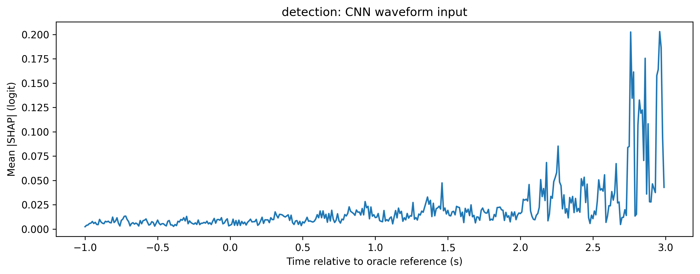

**Figure 8.1. Detection waveform attribution (300 DPI).** Mean absolute SHAP in logit units across all 12 selected validation cases, including the four reconstruction failures. This is an approximate model-input summary; 4/12 initial cases failed the numerical screen, and changing the background shifted the expected logit by 1.974. It is not a physical causal time profile.

### BiLSTM tabular-feature attribution

The highest three mean absolute tabular attributions for detection were **RMS**, **first-difference energy**, and **zero-crossing rate**, in that order. These are rankings of normalized model inputs in the full fused model, not independent physical measurements. Table 8.1 retains all seven saved feature values rather than selecting only the largest effects. Detection and magnitude units differ and should not be compared as a common physical importance scale. [X2]

**Table 8.1. Saved mean absolute SHAP per feature-time input.**

| Tabular feature | Detection (logit units) | Magnitude (target units) |
|---|---:|---:|
| RMS | 0.03085036 | 0.00507899 |
| Mean absolute amplitude | 0.02408469 | 0.00390579 |
| Peak absolute amplitude | 0.01128003 | 0.00269146 |
| Variance | 0.01699800 | 0.00208892 |
| Signal energy | 0.00093070 | 0.00012929 |
| Zero-crossing rate | 0.02564920 | 0.00166648 |
| First-difference energy | 0.02688709 | 0.00298210 |

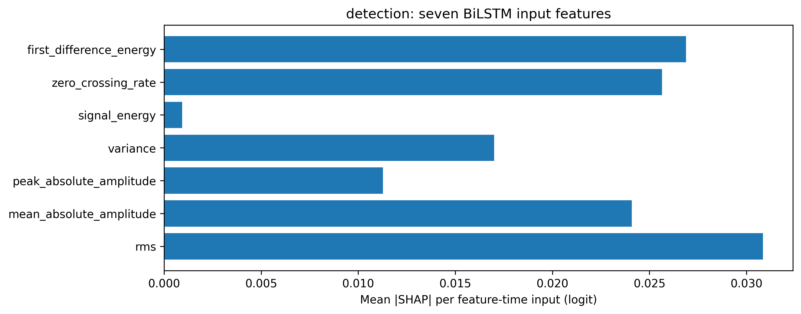

**Figure 8.2. Detection tabular-feature importance (300 DPI).** Approximate mean absolute SHAP over 12 records and 40 bins. All cases are retained despite 4/12 reconstruction failures. Alternative-background feature rank correlation was 0.893; this does not establish reference-invariant importance or causal feature effects.

### Temporal importance and feature-by-time patterns

Figures 8.3–8.4 retain the 40-bin temporal distribution and the separate seven-feature contributions. They describe model-input attribution within the completed window. Because the BiLSTM mixes context bidirectionally, attribution to an input bin is not evidence that the model made its final decision at that time. No exact peak timing or physically dominant phase is inferred from these descriptive plots.

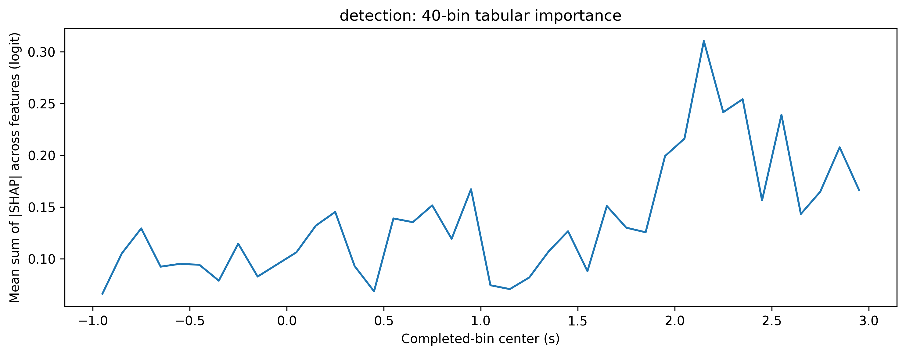

**Figure 8.3. Detection temporal importance (300 DPI).** Mean sum of absolute tabular SHAP across seven features per bin, in logit units. The 4/12 initial failures and background sensitivity remain applicable. This is neither signed detection evidence nor an Attention-weight distribution.

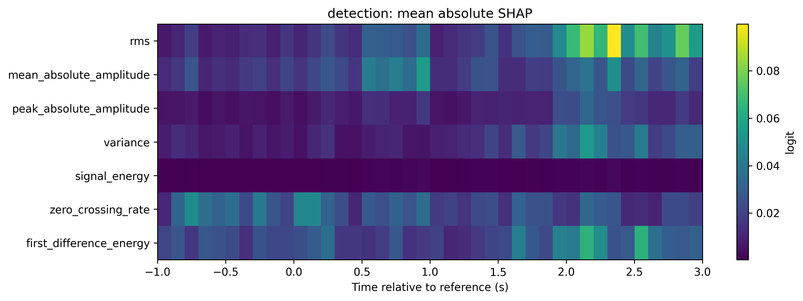

**Figure 8.4. Detection feature-by-time attribution (300 DPI).** Mean absolute SHAP across all 12 cases; sign and between-record variation are not shown. Inputs are dependent, and the original numerical and reference-sensitivity limitations are not removed by aggregation.

### Local detection explanation without success-based selection

The existing local figure uses the first preselected earthquake, NCS_EV_03910, rather than a record chosen for favorable prediction or reconstruction. Its residual is 0.201782 logits, below its heuristic tolerance of approximately 0.25271. It is therefore **not one of the four failed cases**, but it remains an approximate local explanation. The full failed-case table in Section 8.6 accompanies it; the passing example is not presented as representative of universal reliability. [X4, X5]

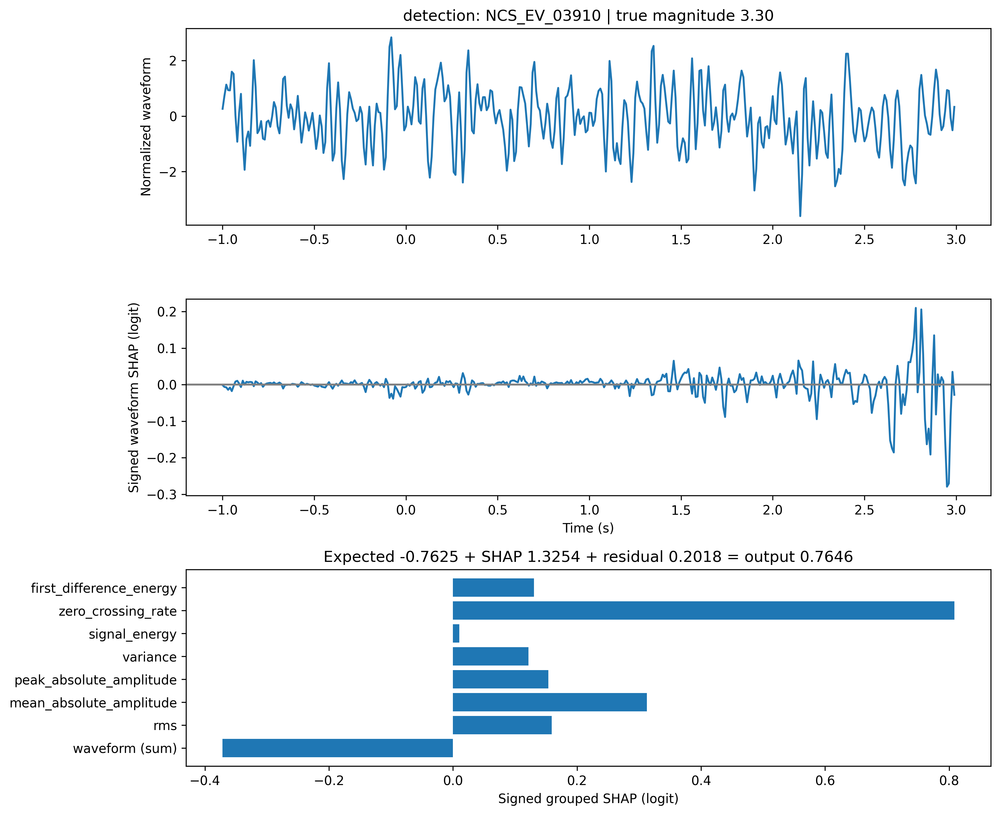

**Figure 8.5. Preselected local detection explanation (300 DPI).** The original figure retains its expected output, signed grouped attributions and 0.201782-logit residual. Passing its tolerance does not make the displayed decomposition exact or convert logit attributions into probability contributions. Background sensitivity still applies.

## 8.5 Magnitude-estimation explanations

Magnitude attribution concerns the nine eligible earthquakes, regardless of detection success. The leading tabular inputs were **RMS**, **mean absolute amplitude**, and **first-difference energy**, in that order (Table 8.1). The observed ranking is compatible with the model assigning substantial attribution to amplitude-related inputs, but it does not establish a physical magnitude law or prove why magnitude compression occurs. The low signal-energy attribution cannot establish physical irrelevance because feature dependence and normalization affect how attribution is distributed.

The waveform and temporal plots use the same definitions as the detection plots, expressed in magnitude units. Initial numerical reconstruction passed 9/9 cases; this is stronger reconstruction evidence for this small cohort, not proof that the magnitude predictions are accurate, calibrated or operationally suitable. [X1–X5]

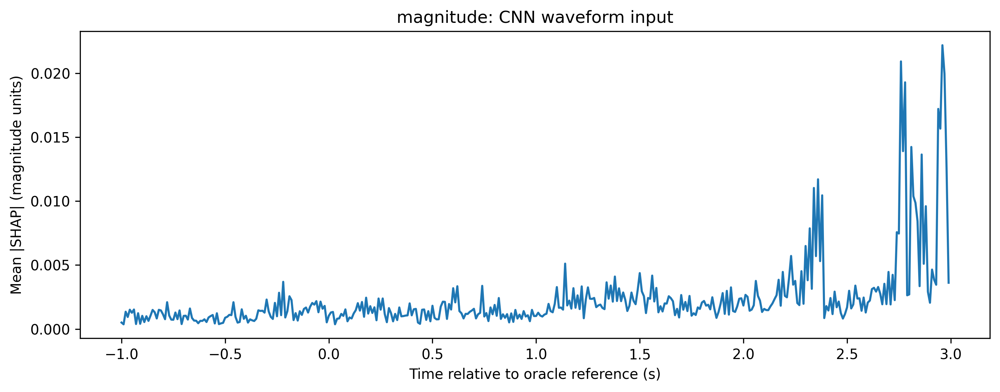

**Figure 8.6. Magnitude waveform attribution (300 DPI).** Mean absolute model-input SHAP over nine selected earthquakes. All nine passed the initial reconstruction screen; shared-source dependence, deliberate strong-event inclusion and the mixed-class mathematical background still limit interpretation. No physical causal timing is asserted.

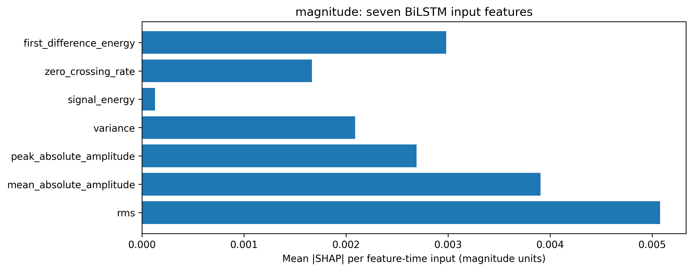

**Figure 8.7. Magnitude tabular-feature importance (300 DPI).** Mean absolute attribution over nine earthquakes and 40 bins. RMS, mean absolute amplitude and first-difference energy have the three largest saved values. The ranking is cohort- and background-specific rather than a population or physical feature ranking.

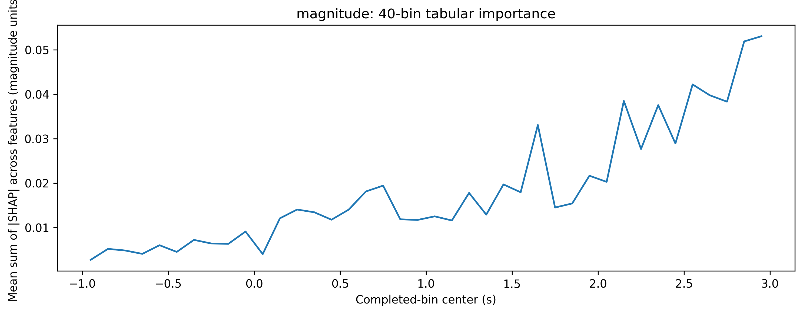

**Figure 8.8. Magnitude temporal importance (300 DPI).** Mean sum of absolute feature attributions per bin, in magnitude units. Bidirectional context spans the full observed window; a high value is not evidence of an isolated causal physical time interval.

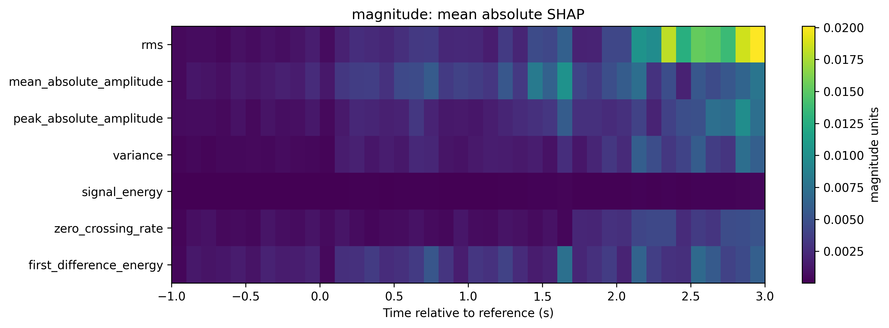

**Figure 8.9. Magnitude feature-by-time attribution (300 DPI).** Mean absolute values suppress sign and individual-record variation. The seven normalized inputs are dependent; the heatmap cannot establish independent physical contributions.

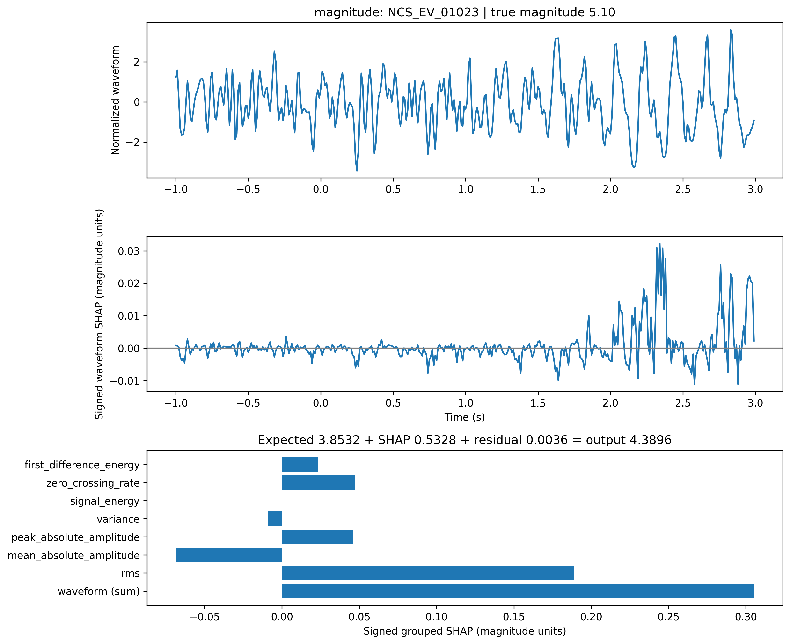

**Figure 8.10. Preselected local magnitude explanation (300 DPI).** The original example is the first selected M≥5 earthquake, chosen without prediction-quality screening. The displayed predicted/true magnitude and reconstruction residual are retained. Numerical reconstruction does not demonstrate accurate magnitude estimation or remove the strong-event underprediction documented in Chapter 6.

## 8.6 Reconstruction validation and targeted reliability check

The completed validation verified frozen predictions, original scalers and weights, paired identities, the observation cutoff, correct SHAP shapes and finite values. The original full-validation loss differed from the approved value by 2.32×10⁻⁷. Returned attribution shapes were (12,400)/(12,40,7) for detection and (9,400)/(9,40,7) for magnitude. These checks were reported previously and were not rerun for report integration. [X2, X4]

The prespecified screen was |r| ≤ 0.1 + 0.1|f(x) − E_B[f]|, in the relevant output units. This is a heuristic numerical tolerance, not a statistical confidence interval or a test of scientific validity. Its dependence on the expected output also means that pass counts from different backgrounds require care.

**Table 8.2. Initial 2,048-draw reconstruction results, primary background.**

| Target and cohort | Passed | Mean absolute residual | Maximum absolute residual | Units |
|---|---:|---:|---:|---|
| Detection, 12 validation records | 8/12 | 0.205840 | 0.622584 | Logits |
| Magnitude, 9 eligible earthquakes | 9/9 | 0.012144 | 0.024013 | Magnitude |

**Table 8.3. All four initial detection failures.** Noise has no physical magnitude target; its stored −1 sentinel is not treated as magnitude.

| Source ID | Type | Magnitude | Signed residual (logits) | Tolerance |
|---|---|---:|---:|---:|
| NOISE_P7567 | Noise | Not applicable | 0.133907 | 0.123463 |
| NCS_EV_03052 | Earthquake | 3.80 | −0.129928 | 0.100058 |
| NCS_EV_07170 | Earthquake | 5.00 | −0.375923 | 0.175875 |
| NCS_EV_02345 | Earthquake | 5.70 | −0.622584 | 0.248819 |

The subsequent targeted reliability check used only these four failures, with two fixed seeds per case and nested 2,048/8,192-draw budgets. It retained 81,920 path draws; a repeated 2,048-draw call after a bookkeeping interruption brought total computation to 83,968 draws, without adding sampling configurations. This was an attribution reliability diagnostic, not training or model tuning. Its newly seeded, failure-focused results must not be conflated with the original 12-record aggregate. [X4]

**Table 8.4. Fixed-budget diagnostic on four failed cases × two seeds.**

| Draws per case/seed | Mean absolute residual | RMS residual | Maximum absolute residual | Passing case/seed runs |
|---|---:|---:|---:|---:|
| 2,048 | 0.212092 | 0.245736 | 0.381776 | 4/8 |
| 8,192 | 0.119120 | 0.144583 | 0.226678 | 5/8 |

Increasing sampling to **8,192 reduced mean reconstruction error but did not establish consistent reliability**: six of eight matched case/seed comparisons improved, and three higher-budget runs still failed. NCS_EV_03052 failed at 8,192 under both seeds; NOISE_P7567 failed under one seed. There was no adaptive sampling extension, tolerance adjustment or substitution of only successful results. The unchanged figures in this chapter contain the original 2,048-draw values, not the later diagnostic values.

The reliability check found no probability/logit mixing, incorrect empirical expected-value calculation or incorrect signed multi-input summation. It also separated residual contributions associated with sampled-background means from the remaining path approximation and floating-point error. Both average absolute components decreased with increased sampling, but this is not a formal variance decomposition or proof of a sole cause. Persistent numerical error remains a reason for the CONDITIONAL verdict. [X4]

## 8.7 Background sensitivity and stability

**Table 8.5. Existing primary-versus-alternative training-background sensitivity.**

| Measure | Detection | Magnitude |
|---|---:|---:|
| Primary expected output | −0.762527 | 3.853153 |
| Alternative expected output | 1.211380 | 3.861201 |
| Expected-output shift | 1.973908 logits | 0.008048 magnitude units |
| Seven-feature rank Spearman correlation | 0.892857 | 0.964286 |
| Feature importance relative L1 difference | 0.136493 | 0.108198 |
| Minimum local signed-attribution cosine | 0.930443 | 0.887271 |
| Waveform aggregate temporal Spearman correlation | 0.954385 | 0.905420 |
| Tabular aggregate temporal Spearman correlation | 0.871482 | 0.975985 |

The same-background seed repeat had feature-rank correlation 1.000 for each target and minimum local cosine 0.991375 for detection and 0.995451 for magnitude. Detection pass counts were 8/12 initially, 10/12 on the seed repeat and 9/12 with the alternative background; magnitude passed 9/9 in all three. Nevertheless, the detection expected logit shifted by approximately 1.974 despite equal coarse stratum counts. Stable rankings therefore do not establish a stable reference value or an exact local decomposition. The magnitude background shift was smaller, but this does not remove local or dependency limitations. Only two existing backgrounds and small validation cohorts were assessed; no population-level stability claim is justified. [X2, X4]

## 8.8 Temporal Attention alongside SHAP

Attention weights govern pooling of contextualized hidden states; SHAP values describe input attribution through the whole network. These quantities answer different questions and have different units. The following figures display them separately. Visual resemblance, or lack of resemblance, cannot validate SHAP or establish that Attention has learned physical importance.

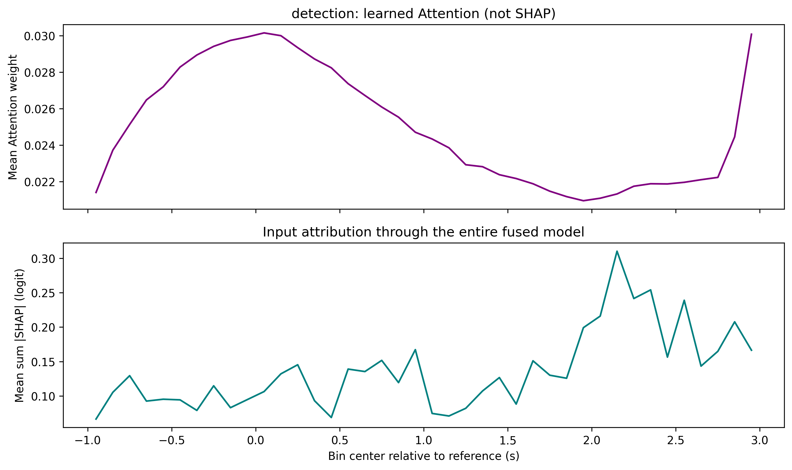

**Figure 8.11. Detection Attention weights alongside SHAP temporal importance (300 DPI).** The upper and lower panels represent different quantities and are not directly comparable scales. Attention weights are not SHAP values. The original detection reconstruction failures and reference sensitivity remain applicable.

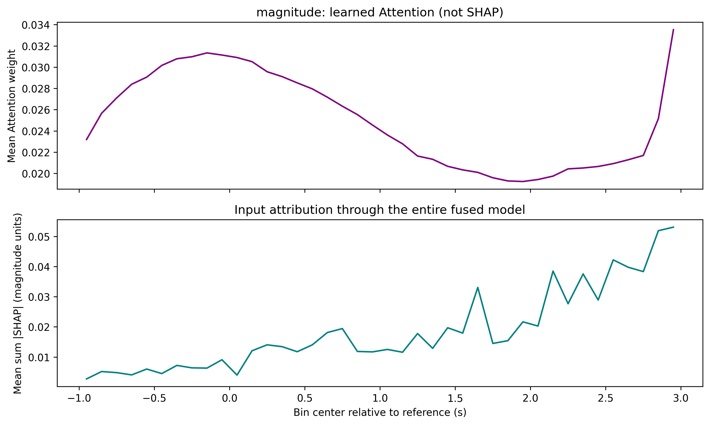

**Figure 8.12. Magnitude Attention weights alongside SHAP temporal importance (300 DPI).** Separate panels distinguish learned pooling weights from magnitude-input attribution. Numerical reconstruction passes do not establish agreement, causality or physical validity of Attention.

## 8.9 Dependent-input limitations and relation to predictive findings

The tabular features are deterministic summaries of the CNN waveform source; they are also internally dependent, including energy = 10×RMS² before normalization for the 10-sample bins. Paired real training records preserve valid endpoints. However, even using the same background record and interpolation coefficient for both tensors does not make intermediate straight-line inputs satisfy nonlinear feature-extraction identities. Physically inconsistent intermediate combinations can therefore arise. Reconstruction can pass for the model on these paths without validating their physical meaning.

These results are **model-input expected-gradient attributions under the chosen background**, not unique physical contributions of independent modalities. SHAP does not establish physical causality or independent branch contributions. It also does not explain why the model's errors are irreducible, prove shortcut learning, establish noise-family effects or demonstrate a physical information limit. Such conclusions are unsupported by the saved analysis.

The four-model comparison remains unchanged: the 3s CNN has the highest fixed-0.5 F1, while Attention has the lowest numerical magnitude MAE; saved paired intervals do not establish Attention improvement over non-Attention fusion. The twelve validation tuning trials still failed their replacement criteria, so the original Attention head remains the explained model. Strong-event underprediction and magnitude compression are predictive errors, whereas SHAP reconstruction residuals are errors in approximate attribution accounting. Passing the latter does not resolve the former. The small validation attribution cohort is distinct from the common test cohort and cannot replace its evaluation.

The final SHAP verdict is **CONDITIONAL**. The study supports qualified descriptions of selected model outputs, with stronger initial numerical reconstruction evidence for magnitude. It does not establish consistently reliable local detection explanations, physical causality, improved prediction accuracy, or operational earthquake-warning readiness.

# Chapter 9 — Conclusion and Future Scope

The four completed and independently approved experiments establish a controlled synthetic comparison, not a warning service. At3s the CNN has the highest fixed-threshold F1 (0.757641), while Attention has the lowest magnitude MAE (0.606601). Neither dominates every objective. Attention has no statistically supported improvement over non-Attention fusion under the saved paired F1/MAE intervals. Additional complexity did not consistently improve this benchmark.

The12-trial study retained the original3s Attention model because no candidate met the predeclared validation replacement rule. Compression, opposite magnitude-tail biases and correlated residuals describe the error patterns, but do not establish frozen features, gradient conflict or an irreducible physical information limit as causes. Negative findings are retained as part of the scientific contribution. No further tuning is recommended at this stage.

Future research should prioritize independent real seismic recordings with verified station/event identity, calibration, magnitude definitions and provenance. Realistic causal triggering must be assessed on continuous streams; false alarms per unit time, missed events, processing latency and physical warning intervals must be distinguished from offline-window metrics. Stronger-event evaluation requires enough genuine observations, severity-aware reporting and uncertainty. Fresh event/station/region-separated held-out data and repeated seeds are necessary for stronger generalization claims.

Oracle alignment, synthetic noise, shared signal sources, single-seed training, minority strong-event counts and historical validation/test reuse limit the conclusions. No operational P-wave triggering, real-world warning lead time, earthquake prediction or Northeast India deployment readiness was established. Attention weights are diagnostics rather than physical explanations. Trustworthy noise-family metadata was unavailable in the inspected schema, so family shortcuts remain UNKNOWN.

The completed SHAP study adds qualified model-input explanations, not improved predictions. Detection initially passed 8/12 reconstruction checks and magnitude passed 9/9; a targeted diagnostic on the four failed detection cases reduced mean absolute residual from 0.212092 to 0.119120 logits at 8,192 draws, while only 5/8 higher-budget case/seed runs passed. These failure-focused diagnostic results are distinct from the initial full explanation cohort. Background sensitivity and the common waveform source of both branches retain the CONDITIONAL verdict. Attribution accounting does not establish physical causality, independent branch contributions, a remedy for magnitude compression or superiority of the retained Attention model.

# References

## External literature and institutional sources

[R1] U.S. Geological Survey. *What is the difference between earthquake early warning, earthquake forecasts, earthquake probabilities, and earthquake prediction?* [Official resource](https://www.usgs.gov/faqs/what-difference-between-earthquake-early-warning-earthquake-forecasts-earthquake-probabilities). Accessed14 November2026.

[R2] Allen, R. M., and Melgar, D. (2019). Earthquake Early Warning: Advances, Scientific Challenges, and Societal Needs. *Annual Review of Earth and Planetary Sciences*,47,361–388. [DOI:10.1146/annurev-earth-053018-060457](https://doi.org/10.1146/annurev-earth-053018-060457).

[R3] National Institute of Disaster Management. *Great Earthquake Occurrences of the North East*. Government of India institutional resource. [PDF](https://nidm.gov.in/PDF/pubs/EQ%20North%20East.pdf). Publication year not established here; indexed title/content verified, full-PDF retrieval timed out.

[R4] Perol, T., Gharbi, M., and Denolle, M. (2018). Convolutional neural network for earthquake detection and location. *Science Advances*,4(2),e1700578. [Author project page and bibliographic record](https://groups.csail.mit.edu/graphics/convnetquake/).

[R5] Hochreiter, S., and Schmidhuber, J. (1997). Long Short-Term Memory. *Neural Computation*,9(8),1735–1780. [DOI:10.1162/neco.1997.9.8.1735](https://doi.org/10.1162/neco.1997.9.8.1735).

[R6] Schuster, M., and Paliwal, K. K. (1997). Bidirectional recurrent neural networks. *IEEE Transactions on Signal Processing*,45(11),2673–2681. [Paper PDF](https://deeplearning.cs.cmu.edu/F20/document/readings/Bidirectional%20Recurrent%20Neural%20Networks.pdf). DOI:10.1109/78.650093.

[R7] Mousavi, S. M., Ellsworth, W. L., Zhu, W., Chuang, L. Y., and Beroza, G. C. (2020). Earthquake transformer—an attentive deep-learning model for simultaneous earthquake detection and phase picking. *Nature Communications*,11,3952. [Publisher PDF](https://www.nature.com/articles/s41467-020-17591-w.pdf). DOI:10.1038/s41467-020-17591-w.

[R8] Münchmeyer, J., Bindi, D., Leser, U., and Tilmann, F. (2020; revised2021). The transformer earthquake alerting model: A new versatile approach to earthquake early warning. [arXiv:2009.06316v4](https://arxiv.org/abs/2009.06316v4). Related journal DOI:10.1093/gji/ggaa609. The inspected arXiv version is cited explicitly.

## Project evidence (not external publications)

All experimental numbers come from these saved project sources. No external article supplies a metric attributed to these models. Chapters3–5 use the specified project counts and the final model reports; Chapters6–7 preserve the integrated results and metric CSV.

- [P1] [final_research_report.md](../../final_comparison/four_model_eew_v2/final_research_report.md) — SHA256 `44e5175aa8d1182f4767dc8df5cfb74f424b0e5f128e6223b2c0790c15fcdf1a`.
- [P2] [final_results_summary.md](../../final_comparison/four_model_eew_v2/final_results_summary.md) — SHA256 `99e8029a4faf99be63ea8fea8472962a735ffedb0866a73642b84fd0cf85162f`.
- [P3] [limitations_and_future_work.md](../../final_comparison/four_model_eew_v2/limitations_and_future_work.md) — SHA256 `69022bd03f3b3dd6a50f1f3ce6076fc3ef457d07e0571441f4fdbe86bac5131d`.
- [P4] [final_metrics_table.csv](../../final_comparison/four_model_eew_v1/final_metrics_table.csv) — SHA256 `cc8c413a7a2bc37d68176fd2451983690af54d8e37b6e14db045ff7d87599cfb`.
- [P5] [final_cnn_eew_report.md](<../../cnn/cnn wave/eew_causal_v3/cnn_eew_training/final_cnn_eew_report.md>) — SHA256 `eaad5e6f58bfab30ac57a6918c8af2370639f10a98c183d0995d0c003a68ce18`.
- [P6] [final_bilstm_eew_report.md](../../bilstm_eew/bilstm_training_v1/final_bilstm_eew_report.md) — SHA256 `e6d42302de5fa8306f47003ebaa820d251e5a206bb13b31a3005a9d191741756`.
- [P7] [final_fusion_report.md](../../fusion/cnn_bilstm_v1/final_fusion_report.md) — SHA256 `f9aa2d12a97cfa7edc3e231bf9bb7181bc0b044f747092b731ba0e30e2ca9fd7`.
- [P8] [final_attention_report.md](../../fusion/cnn_bilstm_attention_v1/final_attention_report.md) — SHA256 `d980e25c9a1eac847ddbdbade33635bf030856dab198699963a411dc6c550e41`.

See the [original figure/table manifest](../academic_final_v1/figure_table_manifest.md), [original quality check](../academic_final_v1/report_quality_check.md), [SHAP figure manifest](shap_figures_manifest.md), and [final consistency check](final_consistency_check.md).

## Explainability evidence added in this revision

The SHAP methodology and results in Chapter 8 are attributed to completed local studies, not to the external seismic literature. Original bibliography entries and access dates are retained from the prior report; external sources were not newly reviewed for this integration.

- [X1] [shap_explainability_report.md](../../explainability/final_attention_shap_v1/shap_explainability_report.md) — SHA256 `63f9c4f891c7950a1fa0092c703f2640d4e38e6691b61a6ab6e83a3697f76b7f`.
- [X2] [shap_validation_report.md](../../explainability/final_attention_shap_v1/shap_validation_report.md) — SHA256 `46d31765345084795dcf04a05c71e27e117420ef56ec189c787ea2f0f69da62d`.
- [X3] [academic_shap_section.md](../../explainability/final_attention_shap_v1/academic_shap_section.md) — SHA256 `ba75bf48d4797edbba742fe254e87b40e8f8930dfab7f634e6a8f5513d5fa4a1`.
- [X4] [reliability_report.md](../../explainability/shap_reliability_v1/reliability_report.md) — SHA256 `6da438ebdd0d31e09fd8df6157ccf823cc9406f6e9ce7dae91b09c93ea3b7d58`.
- [X5] [report_integration_guidance.md](../../explainability/shap_reliability_v1/report_integration_guidance.md) — SHA256 `76cee029969512f473168ac3dc30c11c0e2ce57ab6d7d09943776f0d0092f541`.
